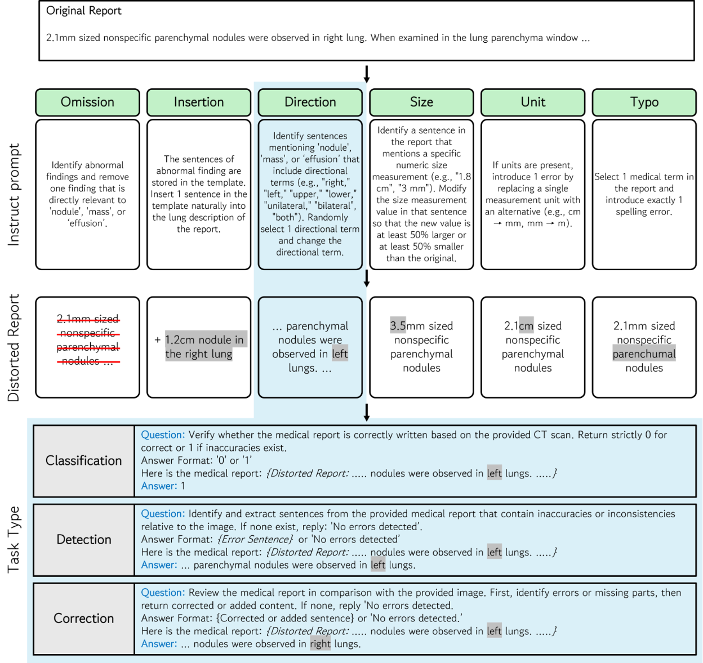
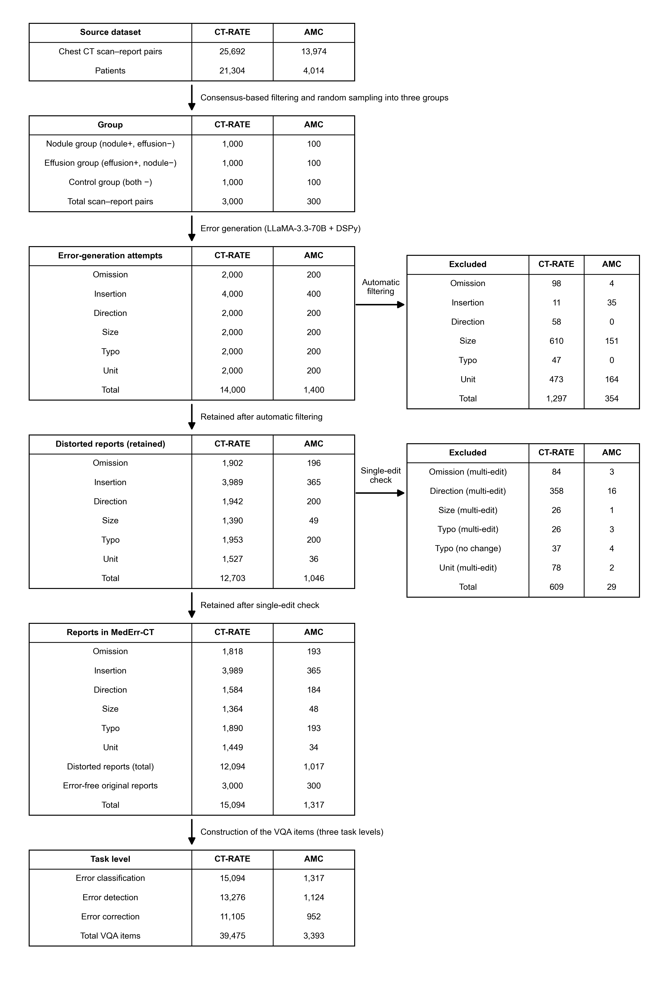

# MedErr-CT

A visual question answering benchmark of vision-centric and lexical errors in chest CT reports.

MedErr-CT pairs chest CT reports with 3D CT volumes and asks a model to judge whether a report contains an error, to find the erroneous sentence and to correct it. Each distorted report contains one error of one of six types: four vision-centric types (omission, insertion, direction, size), which can be recognised only by looking at the images, and two lexical types (typo, unit).

<p align="center"></p>

## Contents

| folder | content |
|---|---|
| `data/` | question–answer files of the three tasks and the list of reports removed by the single-edit check |
| `data_generation/` | code that built the dataset: case selection, error generation with its prompts and insertion sentences, question–answer construction, the single-edit check and the script that writes the released files |
| `evaluation/` | scoring code (accuracy, SIM, GREEN, clinical accuracy) |

## Data

| file | task | items |
|---|---|---|
| `data/classification.json` | error classification | 15,094 |
| `data/detection.json` | error detection | 13,276 |
| `data/correction.json` | error correction | 11,105 |

The 39,475 items are derived from 3,000 scan–report pairs (2,835 patients) of the [CT-RATE](https://huggingface.co/datasets/ibrahimhamamci/CT-RATE) training split. The files contain text only; download the CT volumes from CT-RATE and link them through the `volume` field. The fields are described in [`data/README.md`](data/README.md).

<p align="center"></p>

The figure also shows the counts of the AMC dataset, a private dataset used for validation in the paper; it is not part of this repository.

The prompt given to a model is

```python
prompt = item["question"] + "\nHere is the medical report: '''" + item["report"] + "'''"
```

## Evaluation

Error classification is scored with accuracy and error detection with soft index matching (SIM). Write the model outputs to a CSV file with the columns `id` and `prediction` (one row per item; leave `prediction` empty when the model produced no output). Empty or unparsable outputs are scored as incorrect.

```bash
python evaluation/evaluate.py --task classification --data data/classification.json --pred predictions.csv
python evaluation/evaluate.py --task detection --data data/detection.json --pred predictions.csv
```

Error correction is scored with GREEN. The script reads a CSV file with a column `Ground Truth` (the `answer` field of `data/correction.json`) and a column with the model outputs, and writes one score per row.

```bash
python evaluation/evaluation_green.py --input_csv correction_outputs.csv --model_name <column of model outputs> --output_dir green_scores.csv
```

`evaluation/evaluation_ca.py` takes the same input (`--target_model <column>`) and computes the clinical-accuracy score with GPT-4o mini; set `OPENAI_API_KEY` before running it.

Requirements: `pandas`, `numpy` and `rouge` for `evaluate.py`, `green_score` and `transformers` for GREEN, `dspy` for the clinical-accuracy score.

## Data generation

1. **Case selection and sampling.** `data_generation/case_selection_dspy.py` assigns each report to the nodule, effusion or control group and draws a random sample of 1,000 cases per group. It writes `nodule_sample_1000.csv`, `effusion_sample_1000.csv` and `none_sample_1000.csv`, with the lung section of each report in the column `lung_section` (see `--help` for the inputs).
2. **Error generation** with DSPy and LLaMA-3.3-70B (served with Ollama). The script reads the three files of step 1 and writes `dspy_nodule.csv`, `dspy_effusion.csv` and `dspy_none.csv`.

   ```bash
   python data_generation/error_generation_dspy.py --csv_path <folder of step 1> --save_path <output folder>
   ```
3. **Question–answer construction.** `data_generation/vqa_construction.ipynb` builds the items of the three tasks from the files of step 2 and writes one JSON file per task level.
4. **Single-edit check.** Distorted reports with no change or with changes in more than one place are listed for exclusion.

   ```bash
   python data_generation/single_edit_check.py --csv_dir <output folder of step 2> --out exclusion_list.csv
   ```

5. **Released files.** The reports listed in step 4 are removed and the items are written in the format of `data/`.

   ```bash
   python data_generation/build_release.py --item_dir <output folder of step 3> --csv_dir <output folder of step 2> --exclusion exclusion_list.csv --out_dir data
   ```

The prompts of the six error types are in `data_generation/error_generation_prompt.py`, and the sentences used for insertion errors in `data_generation/insertion_template.py`.

## Licence

The code is released under the MIT licence ([LICENSE](LICENSE)). The files in `data/` are derived from CT-RATE and are released under the same licence as CT-RATE, [CC BY-NC-SA 4.0](https://creativecommons.org/licenses/by-nc-sa/4.0/).

## Citation

If the dataset or the code is useful for your work, please cite the preprint ([arXiv:2506.19217](https://arxiv.org/abs/2506.19217)):

```BibTeX
@misc{kyung2025mederrctvisualquestionanswering,
      title={MedErr-CT: A Visual Question Answering Benchmark for Identifying and Correcting Errors in CT Reports}, 
      author={Sunggu Kyung and Hyungbin Park and Jinyoung Seo and Jimin Sung and Jihyun Kim and Dongyeong Kim and Wooyoung Jo and Yoojin Nam and Sangah Park and Taehee Kwon and Sang Min Lee and Namkug Kim},
      year={2025},
      eprint={2506.19217},
      archivePrefix={arXiv},
      primaryClass={cs.CV},
      url={https://arxiv.org/abs/2506.19217}, 
}
```

## Acknowledgement

The evaluated models are available from their official repositories:
[RadFM](https://github.com/chaoyi-wu/RadFM),
[M3D](https://github.com/BAAI-DCAI/M3D),
[CT-CHAT](https://github.com/ibrahimethemhamamci/CT-CHAT),
[Med3DVLM](https://github.com/mirthai/med3dvlm),
[MedM-VL](https://github.com/MSIIP/MedM-VL).
